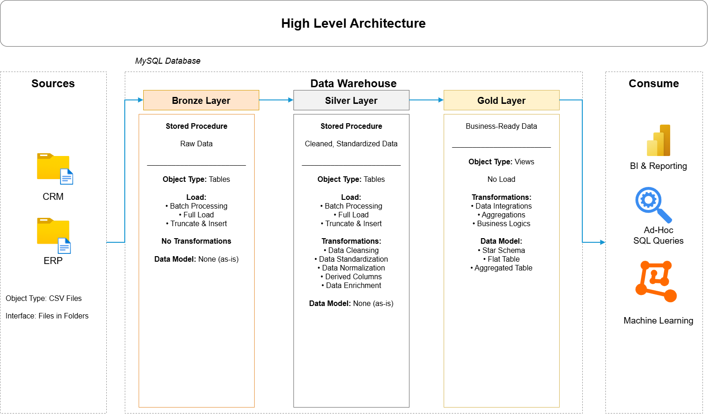
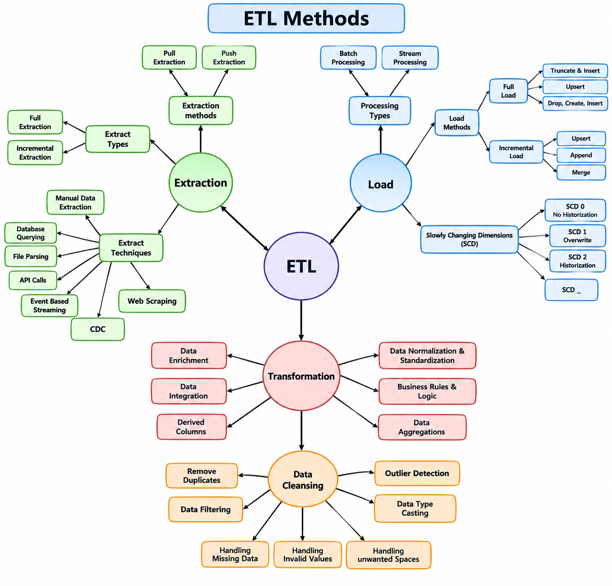

# SQL Data Warehouse Project

## Project Overview

This project focuses on designing and implementing a modern SQL Data Warehouse using **MySQL** and the **Medallion Architecture (Bronze, Silver, and Gold layers)**.

It integrates data from multiple source systems (CRM and ERP) to build a structured and analytics-ready data environment.

The project demonstrates practical SQL skills through data ingestion, data cleaning, transformation, data integration, data quality validation, and dimensional data modelling.

## Project Objectives

- Design and develop a SQL Data Warehouse using MySQL.
- Integrate CRM and ERP data from CSV source files.
- Implement Bronze, Silver, and Gold layers using Medallion Architecture.
- Clean, standardize, and transform raw data using SQL.
- Develop stored procedures to manage data loading.
- Create analytical views using dimensional data modelling.
- Perform data quality checks to validate data accuracy and consistency.
- Prepare customer, product, and sales data for analytical reporting.

## Project Requirements

### 1. Data Warehouse Development

**Objective:** Develop a modern SQL Data Warehouse to consolidate CRM and ERP data and support analytical queries.

**Specifications:**

- **Data Sources:** Import CRM and ERP datasets provided as CSV files.
- **Data Integration:** Combine data from multiple source systems.
- **Data Quality:** Identify and address data quality issues.
- **Data Transformation:** Clean, standardize, and transform data using SQL.
- **Data Modelling:** Develop analytical views for customer, product, and sales data.
- **Documentation:** Maintain documentation of the architecture, data flow, and data models.

### 2. SQL-Based Analytics

Prepare the data warehouse to support analysis of:

- Customer behaviour
- Product performance
- Sales trends

## Technologies Used

- **MySQL** – Database management and SQL-based transformations.
- **MySQL Workbench** – Database development and query execution.
- **SQL** – Data ingestion, cleaning, transformation, joins, stored procedures, and views.
- **Git & GitHub** – Version control and project documentation.
- **Draw.io** – Data warehouse architecture and process diagrams.

## Project Architecture

This project follows the **Medallion Architecture**, organizing data into three layers:

- **Bronze Layer:** Stores raw data ingested from CRM and ERP CSV files.
- **Silver Layer:** Stores cleaned, standardized, and transformed data.
- **Gold Layer:** Provides business-ready analytical views for customer, product, and sales analysis.

### High-Level Architecture

## ETL Process

The data warehouse follows an ETL (Extract, Transform, Load) process to move data from source systems into analytical layers.

1. **Extract:** Import CRM and ERP data from CSV files into the Bronze Layer.
2. **Transform:** Clean, standardize, and validate the data in the Silver Layer.
3. **Load:** Prepare business-ready analytical views in the Gold Layer.

### ETL Methods

## Data Sources

The project uses two source systems containing CSV datasets:

- **CRM (Customer Relationship Management):** Provides customer information, product details, and sales transactions.
- **ERP (Enterprise Resource Planning):** Provides additional customer, location, and product category information.

The datasets are integrated to create a unified data warehouse for analytical purposes.

## Data Model

The Gold Layer contains three analytical views designed to support business reporting and analysis.

| View Name | Description |
|---|---|
| `gold.gold_dim_customers` | Customer dimension containing customer details and demographic information. |
| `gold.dim_product` | Product dimension containing product details, categories, and product attributes. |
| `gold.fact_sales` | Sales fact view containing transaction details, customer keys, product keys, and sales measures. |

The customer and product dimensions are connected to the sales fact view through their respective keys, supporting analytical queries across customers, products, and sales.

